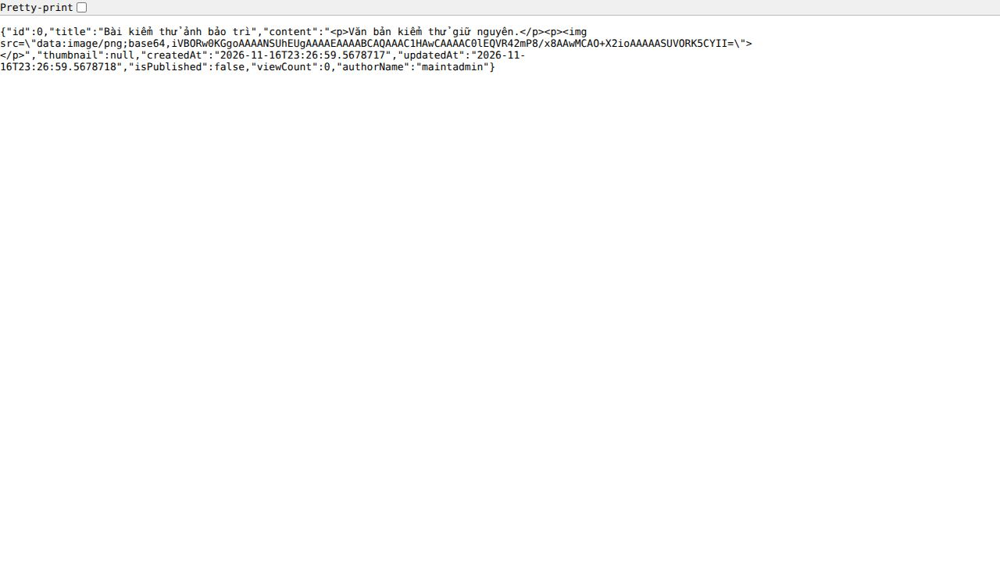
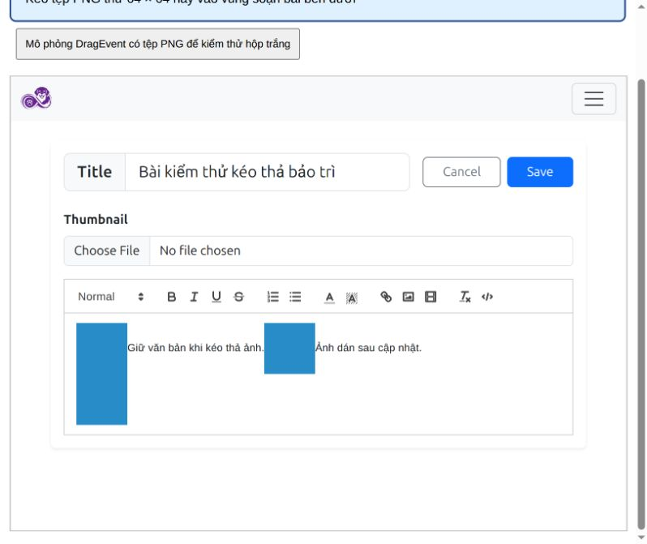

# Báo cáo kiểm thử bảo trì MyDogNet HC01 HC02 DP01 DP03

Ngày thực hiện: 17/11/2026 (Asia/Ho_Chi_Minh). Phạm vi: đúng bốn yêu cầu HC01, HC02, DP01, DP03. Không tuyên bố đã sửa HC03, HC04, HT01, HT02, HT03 hoặc DP02 đã rút.

## Kết luận thực tế

Đã sửa mã nguồn của cả bốn mục và thực thi **27 kịch bản API/CSDL/hộp trắng**: 27 đạt, 0 không đạt trong lần chạy cuối. Có thêm 4 luồng giao diện, trong đó kéo thả được mô phỏng bằng DragEvent có File, và một phép đo tải nhẹ NFR07. Số này là kịch bản thực thi của harness, **không phải khẳng định toàn bộ 55 ca trong kế hoạch cũ đều đạt**.

Các kết quả tích hợp dùng SQL Server thật trong CSDL riêng, **Cloudinary giả lập**. Chưa nghiệm thu xóa trên tài khoản Cloudinary thật, proxy thật/nhiều instance, hoặc kéo tệp từ trình quản lý file hệ điều hành. Vì vậy kết luận chấp nhận trong phạm vi sandbox, chưa phải chứng nhận production.

## Tài liệu và mốc mã nguồn

Đã đọc bản mới nhất trong thư mục Drive `1N3ONPEoH6a6mRVPIFL8hQlqFb7AXcKD3`, đặc biệt tài liệu kiểm thử, đặc tả, thiết kế và kế hoạch. Bản gốc tải về được giữ trong `drive_goc/`; kế hoạch trên Drive đã được người dùng cập nhật ngày 16/11 nên không thay bằng bản local cũ. Hai ảnh yêu cầu đính kèm xác nhận danh mục và đầu ra cần đạt. Mốc Git nền: `1d0ddc344d3be4c9297831cc1875ea8acb8f5ace`; mã sửa chưa commit, định danh nội dung bằng `source-sha256.json`.

Nguồn kỹ thuật tham khảo: [Quill Clipboard](https://quilljs.com/docs/modules/clipboard), [EF Core Transactions](https://learn.microsoft.com/en-us/ef/core/saving/transactions), [Cloudinary .NET](https://cloudinary.com/documentation/dotnet_integration).

## Sandbox và cách cô lập

- Bản trước: snapshot mã ở `sandbox/baseline/`, backend cổng 5190, frontend 5174, CSDL `MyDogNetMaintenanceBefore`.
- Bản sau: `maintenance-tests/` dùng WebApplicationFactory và SQL `MyDogNetMaintenanceAfter_<timestamp>`, frontend 5175; cầu nối HTTP kiểm thử 5191 chỉ dùng cho thao tác giao diện. SQL cùng máy chủ local cổng 14333 nhưng khác CSDL MyDogNetLocal.
- FakeCloud thay duy nhất ICloudinaryServices trong host kiểm thử: lưu bytes trong bộ nhớ, ghi lần xóa, chủ động gây lỗi upload/delete. Không dùng khóa Cloudinary thật, không xóa ảnh thật. URL giả lập có dạng `/sandbox-assets/...`; URL của provider Cloudinary thật vẫn là HTTPS do SDK trả về.
- Tài khoản Admin, Editor A/B, tài khoản khóa và dữ liệu ảnh đều là fixture. Có guard tên CSDL trước migrate/seed. Mỗi lần chạy suite tạo tên DB mới. Không gửi yêu cầu dò mật khẩu vào website deploy.
- Kiểm thử cơ chế lưu và dọn dùng khóa SQL thật UPDLOCK trong giao dịch, không dùng EF InMemory để suy luận kết quả tranh chấp.
- Thông tin kết nối, JWT và mật khẩu không được đưa vào báo cáo hoặc bản Word; môi trường riêng được giữ ở `.local/maintenance/` của repo, Git bỏ qua.

## HC01 Thiếu xác thực và quyền quản trị

**Lỗi và lý do bảo trì:** DELETE bài chưa có Authorize; khách đọc/cấp tài khoản; PATCH không đối chiếu chủ sở hữu. FE coi `aud=Admin` là vai trò. Có thể gọi thẳng API để thay đổi dữ liệu dù giao diện giấu route.

**Tái hiện trước sửa:** khách GET /Account nhận 200, đọc được tài khoản sandbox; DELETE /Post/2 nhận 204 và xóa được bài thử. Dữ liệu nằm trong baseline-results.json, không dùng dữ liệu thật.

**Khắc phục:** JWT có role claim; API kiểm tra Admin/Editor và AuthorId/Id tài khoản; danh sách/cấp tài khoản chỉ Admin; PATCH whitelist trường. GET quản trị riêng và NoStore; bài nháp không lộ qua URL công khai. FE gửi token qua interceptor, bảo vệ route bằng role, Editor không thấy menu Accounts. Sửa lỗi dialog xóa bị unmount trước khi đóng để luồng xóa hợp lệ còn hoạt động.

**Tương thích tài khoản cũ:** không tự nâng tất cả người dùng thành Admin. Có lệnh offline `--grant-admin=<username>` và `--grant-editor=<username>`, phải xác định đúng người được cấp. Token cũ không có role cần đăng nhập lại. Phần lọc bài công khai là điều kiện bảo vệ dữ liệu; chưa triển khai toàn bộ workflow HT01.

**Kết quả:** sáu ca HC01 của harness đạt: khách 401, sai chủ 403, chủ/Admin hợp lệ, tạo tài khoản đúng quyền, token hết hạn/sửa role bị từ chối; bài và hồ sơ không đổi khi bị chặn.

## HC02 Ảnh base64 làm request bài quá lớn

**Lỗi và lý do bảo trì:** Quill mặc định chèn data URI; POST/PATCH lưu Content không giới hạn. Payload lớn gây tốn bộ nhớ và kéo dài xử lý. Lỗi treo server do rất nhiều ảnh do người vận hành báo; không tự nhận đã tái hiện OOM trong lần này.

**Tái hiện trước sửa:** bài sandbox lưu được `data:image/png;base64` trong Content. Chỉ dùng ảnh nhỏ để chứng minh sai luồng, không cố làm treo máy.

**Khắc phục:** RichTextEditor dùng chung cho Create/Update. Toolbar, paste tệp hoặc HTML data URI, drop tệp gọi upload multipart; chỉ chèn URL sau thành công. Nút Save khóa lúc upload. MIME/chữ ký JPEG/PNG/WebP, 5 MiB/tệp; API độc lập chặn data URI, trên 20 ảnh, JSON trên 1 MiB. Ngoại lệ upload trả 502 chung, không trả stack trace/khóa. Lưu URL và MediaReference trong giao dịch. Lỗi ghi CSDL sau upload có bước xóa bù; nếu cả xóa bù cũng lỗi cần vận hành đối soát, không thể cam kết xóa dịch vụ ngoài khi mất mạng.

**Chuyển dữ liệu cũ:** CLI dry-run/apply; backup JSON trước apply; PublicId xác định theo bài/checksum và MediaAsset làm checkpoint. Chỉ cập nhật Content sau đủ ảnh và kiểm tra bài không bị sửa đồng thời. Thử lỗi ảnh thứ hai: bài gốc còn nguyên; chạy lại chỉ upload phần thiếu. Các inline CSS/data URI không được hỗ trợ sẽ để pending, không bỏ mất ảnh.

**Lỗi phát hiện trong quá trình sửa:** khi khóa Quill, insertEmbed với source=user bị bỏ qua. Đổi lệnh chèn từ ứng dụng sang source=api đã được xác nhận bằng UI. Một lần Save thất bại trong lúc đổi cấu hình Vite và tab kẹt ở thông báo; không có bằng chứng đó là server quá tải. Lần chạy lại bằng tab mới đã tạo và cập nhật bài thành công.

**Kết quả:** các ca API biên/giả tệp/20–21 ảnh/JSON/base64/migration/checkpoint đạt. Toolbar và paste đã thao tác trên trình duyệt; drop kiểm thử hộp trắng bằng DragEvent có File. Nội dung sau thao tác chứa URL, không có data:image. Các ảnh giao diện lưu ở anh_truoc_sau/.

## DP01 Ảnh upload bỏ dở và dọn nhầm ảnh đang dùng

**Lỗi và lý do bảo trì:** trước sửa chỉ trả SecureUrl, không lưu PublicId/OwnerId hay tham chiếu. Ảnh được upload trước khi đăng bài có thể thành rác; dọn cả thư mục temp có thể làm mất ảnh đang dùng.

**Khắc phục:** bảng MediaAsset/MediaReference, các trạng thái Temp/Used/Deleting/Deleted/DeleteFailed. Lưu bài/hồ sơ khóa asset và kiểm tra quyền/state rồi cập nhật tham chiếu cùng giao dịch. Worker mặc định chưa xóa thật; dry-run, tuổi 24 giờ, batch 100, tối đa ba lần, lịch 24 giờ. Claim Deleting trong SQL trước lời gọi dịch vụ. Giữ ảnh Used, ảnh trong nháp/content/thumbnail/avatar/background, ảnh mới 23 giờ và ảnh cũ không đăng ký. Kiểm tra cả URL legacy trong dữ liệu trước xóa; không đổi URL bằng cách thay chữ temp thành posts.

**Kết quả:** dry-run không sửa; Temp 25 giờ được dọn trong fake store; ảnh dùng/nháp/hồ sơ được giữ; 10 lần tranh chấp save-cleanup không tạo tham chiếu tới Deleted; hai worker chỉ gọi xóa một lần; lỗi dịch vụ giữ DeleteFailed, không Deleted giả và dừng ở lần ba. Chưa đợi 24 giờ thực tế hoặc xóa tài khoản Cloudinary thật. Migration ban đầu từng gặp SQL multiple cascade paths; đã đổi FK tham chiếu hồ sơ sang Restrict và chạy thành công từ DB sạch.

## DP03 Dò mật khẩu qua route đăng nhập

**Lỗi và lý do bảo trì:** tên route xuất hiện trong mã/bundle nên giấu URL không ngăn brute force. Trước sửa lockoutOnFailure=false, không có hạn IP: request 21 vẫn 401, sau năm sai vẫn đăng nhập đúng nhận 200.

**Khắc phục:** 20 lần/cửa sổ trượt 60 giây theo IP kết nối, nhận 429/Retry-After từ lần 21. Chuẩn hóa hoa/thường và slash cuối để tránh bỏ qua limiter. Bật Identity khóa 15 phút sau năm sai. Khóa hàng SQL quanh kiểm tra đăng nhập để không mất bộ đếm khi cùng tài khoản bị thử đồng thời. Thông báo 401 chung và log sự kiện không chứa mật khẩu/token. Không tin X-Forwarded-For nếu chưa cấu hình proxy cụ thể.

**Kết quả:** năm sai tuần tự và đồng thời đều khóa; host mới vẫn bị khóa; đặt LockoutEnd về quá khứ trong fixture mô phỏng hết 15 phút thì đăng nhập được và đếm sai=0. 20 yêu cầu nhận 401 rồi 429, kể cả đổi XFF và route có slash/khác chữ hoa. 40 tác vụ limiter cùng lúc chỉ nhận 20. Đây là limiter một instance: khởi động lại đặt lại cửa sổ IP, khóa Identity vẫn lưu SQL. Chưa thử gateway hoặc nhiều instance dùng kho hạn mức chung.

## Kết quả tự động lần cuối

| Mã | Kết quả | Thực tế |
|---|---|---|
| TC-HC01-01 | PASS | DELETE/Account 401; bài còn nguyên |
| TC-HC01-02 | PASS | 401 cho JWT hết hạn |
| TC-HC01-03 | PASS | Editor khác chủ nhận 403 ở bài và hồ sơ |
| TC-HC01-04 | PASS | Chủ bài và Admin sửa thành công |
| TC-HC01-05 | PASS | Khách 401; Editor 403; Admin cấp Editor thành công |
| TC-HC01-06 | PASS | 401 khi sửa role giữ chữ ký cũ |
| API-HC02-BOUNDARY | PASS | 5 MiB nhận; +1 byte từ chối; tệp giả 400 (dịch vụ ảnh giả lập) |
| TC-HC02-07 | PASS | POST/PATCH 400; không lưu data URI |
| API-HC02-STORE | PASS | Content URL và MediaReference được lưu trong SQL thật |
| TC-HC02-05 | PASS | 20 ảnh nhận, 21 ảnh 400, JSON >1 MiB 413 |
| API-HC02-OUTAGE | PASS | Cloud timeout giả lập → 502 chung |
| TC-HC02-08 | PASS | Dry-run không ghi; chuyển 1 bài; chạy lại không upload trùng; giữ strong/text |
| TC-DP01-01 | PASS | Dry-run giữ dữ liệu; chạy thật trên fake store đánh dấu Deleted |
| TC-DP01-02-03 | PASS | Giữ Temp 23h, Used, ảnh có tham chiếu bài |
| TC-DP01-05 | PASS | DeleteFailed, Attempts=3; không đánh dấu Deleted giả |
| TC-DP01-04 | PASS | 10 tranh chấp: không có tham chiếu tới ảnh Deleted |
| DP01-PROFILE-DRAFT | PASS | Giữ ảnh content/thumbnail/nháp/avatar/background, gồm URL cũ chưa có MediaReference |
| DP01-TWO-WORKERS | PASS | Hai worker: đúng một lần gọi xóa asset |
| DP01-FOREIGN-ASSET | PASS | Editor B dùng ảnh A nhận 403, giao dịch rollback |
| HC02-MIGRATION-RESUME | PASS | Lỗi ảnh thứ hai: bài cũ còn nguyên; chạy lại chỉ upload ảnh còn thiếu |
| TC-DP03-02 | PASS | 5 sai: khóa lưu SQL >14 phút; mật khẩu đúng vẫn 401 |
| DP03-ACCOUNT-CONCURRENT | PASS | 5 yêu cầu sai đồng thời vẫn khóa tài khoản 15 phút trong SQL |
| DP03-RESTART | PASS | Host/limiter mới vẫn nhận 401 vì khóa tài khoản lưu SQL |
| TC-DP03-03 | PASS | Đặt LockoutEnd quá khứ trong fixture (mô phỏng 15 phút); đăng nhập được, đếm sai=0 |
| TC-DP03-04-05 | PASS | 20×401 rồi 429 + Retry-After; đổi XFF không qua được hạn |
| WB-DP03-CONCURRENT | PASS | 40 tác vụ: đúng 20 được nhận |
| RG03 | PASS | AboutMe/Post 200 sau các ca lỗi/race |

## Kiểm thử giao diện

| Mã | Kết quả | Thực tế và giới hạn |
|---|---|---|
| UI-HC02-TOOLBAR | PASS | Chọn PNG 64×64 trên toolbar; thấy URL nội bộ của fake store, Save bị khóa khi upload. |
| UI-HC02-PASTE | PASS | Dán HTML có PNG base64 bằng clipboard; ảnh được thay bằng URL và văn bản còn nguyên. |
| UI-HC02-DROP-MOCK | PASS | Bấm harness phát DragEvent có File PNG; handler drop upload và chèn URL. Chưa xác nhận kéo file từ hệ điều hành. |
| UI-HC02-SAVE | PASS | Tạo bài bằng giao diện, mở lại trang sửa còn ảnh; thêm toolbar/paste thành 3 URL rồi PATCH thành công, quay lại Post Manager. |

## Đo NFR07

Hai lần đo cùng máy, cùng SQL server, pageSize=5, số lượng bài thử tương đương; sau làm nóng 10 GET, gửi 50 GET trong pool tối đa 6 tác vụ đồng thời với một POST chứa 20 URL ảnh. Provider ảnh không được gọi trong POST này, đúng mô hình sau upload. Không phải thử tải production hoặc tái hiện server OOM.

| Mốc | p95 GET | Max GET | CPU tiến trình trong cửa sổ đo | RSS cao nhất lấy mẫu | HTTP |
|---|---:|---:|---:|---:|---|
| Trước | 7.6 ms | 8.02 ms | 180.0 ms | 183.98 MiB | 50×200; POST 200 |
| Sau | 7.0 ms | 7.3 ms | 170.0 ms | 199.08 MiB | 50×200; POST 200 |

p95 sau nhỏ hơn 3 giây và không quá hai lần baseline trong mẫu đo này. CPU là tổng thời gian CPU của tiến trình API/harness trên nhiều lõi; không bao gồm SQL Server. RSS lấy mẫu khoảng 5 ms, không phải đỉnh bộ nhớ tuyệt đối. Bản sau có thêm cầu nối HTTP TestServer nên phép đo dùng cho kiểm tra hồi quy nhỏ, không dùng suy luận năng lực hosting.

## Ảnh và bằng chứng

- [HC01 trước: khách đọc tài khoản](anh_truoc_sau/HC01_truoc_danh_sach_tai_khoan.png).
- [HC02 trước: Content chứa base64](anh_truoc_sau/HC02_truoc_noi_dung_base64.jpg).
- [HC02 sau: chọn ảnh toolbar](anh_truoc_sau/HC02_sau_toolbar.jpg).
- [HC02 sau: paste ảnh](anh_truoc_sau/HC02_sau_paste.jpg).
- [HC02 sau: drop mô phỏng](anh_truoc_sau/HC02_sau_drop_mo_phong.jpg).
- [HC02 sau: bài tạo được](anh_truoc_sau/HC02_sau_luu_bai.jpg).
- [HC02 sau: ba ảnh khi cập nhật](anh_truoc_sau/HC02_sau_ba_anh_URL.jpg).

**Ảnh chưa có:** ảnh phản hồi API trực tiếp sau sửa và ảnh bảng kết quả DP01/DP03 chưa chụp được: công cụ trình duyệt bị cài đặt quyền đã lưu/chính sách từ chối localhost:5191 và localhost:5180, kể cả sau khi người dùng xác nhận cho phép. Không thay bằng ảnh dựng rồi gọi là ảnh màn hình thật. Các trang bảng kết quả tĩnh ở minh_chung/ chỉ là bản trình bày dữ liệu, chưa có ảnh chụp và không được dùng làm chứng cứ UI.

Dữ liệu gốc: baseline-results.json, results.json, browser-results.json, performance.json, sandbox/test-execution.log. Harness và fixture ở repo maintenance-tests/. Số đo và ảnh không chứa khóa Cloudinary/JWT hoặc mật khẩu.

## Hồi quy và phần chưa nghiệm thu

Đã build backend/frontend; GET AboutMe/Post còn 200; tạo/sửa bài qua UI hoạt động; API có quyền vẫn sửa được, sai quyền không đổi dữ liệu. Chưa thực hiện đầy đủ RG01–RG05 theo mọi bước của kế hoạch 55 ca (tìm kiếm, đăng xuất, thiết bị thật, hồi phục SQL backup, worker theo 24 giờ thực tế). Trong bản Word, chỉ điền đúng bằng chứng đã có, giữ trạng thái chưa thực hiện hoặc một phần cho các bước còn thiếu.

## Hướng dẫn áp dụng và chạy lại

Xem docs/BAO_TRI_HC01_HC02_DP01_DP03.md trong repo. Dừng API, sao lưu, restore/build, áp dụng migration MediaLifecycle rồi cấp đúng role cho tài khoản chủ qua CLI. Chạy chuyển base64 dry-run trước apply. Job xóa thật chỉ bật sau đối soát dry-run; không tự xóa ảnh thật trong lần sửa này.

Để chạy harness: cấp ConnectionStrings__DefaultConnection trỏ CSDL **MyDogNetMaintenanceAfter_...** (guard tên), JWT__SecretKey ngẫu nhiên ≥32 byte, JWT__ValidIssuer/ValidAudience cho test, ASPNETCORE_ENVIRONMENT=Testing, MediaCleanup__Enabled=false, MAINTENANCE_OUTPUT tới thư mục kết quả. Chạy dotnet run --project maintenance-tests. Chỉ dùng thông tin kết nối local qua cấu hình riêng; không copy vào báo cáo. Bộ test tạo fixture và apply migration vào đúng DB thử, không xóa DB thật.

## Áp dụng local sau kiểm thử

Đã tạo SQL COPY_ONLY backup `MyDogNetLocal_before_maintenance_20261117002635.bak` trong volume SQL Server tại `/var/opt/mssql/data/`, áp dụng migration `20261116232845_MediaLifecycle` thành công vào MyDogNetLocal và cấp vai trò Admin cho tài khoản localadmin qua CLI. Cần đăng nhập lại để nhận token có role. Không chuyển ảnh hoặc bật xóa Cloudinary thật trong bước này. Chưa thử khôi phục bản backup.

## Xác nhận cuối

Bốn mục đã có sửa đổi và bằng chứng sandbox như trên. Các giới hạn đã nêu chưa được coi là đạt. Chưa commit, push hoặc deploy website thật; không tự ghi tên người phê duyệt hay giờ công thực tế khi chưa có dữ liệu.

## Cập nhật tài liệu Drive

Đã thay nội dung đúng sáu file DOCX gốc trong [thư mục Drive](https://drive.google.com/drive/u/1/folders/1N3ONPEoH6a6mRVPIFL8hQlqFb7AXcKD3), giữ ID và thư mục, ngày 17/11/2026. Đã đọc lại cả sáu bản từ Drive và xác nhận phiên bản 0.2, ngày cập nhật cùng nội dung kết quả thực thi. Biên nhận lưu ở drive-update-receipts.json; bản chỉnh lưu ở word_cap_nhat/, bản trước chỉnh giữ ở drive_goc/.

Lệnh tái kiểm thử cho người tiếp nhận: `python3 maintenance-tests/run.py` từ thư mục MyDogNet. Đã chạy kiểm chứng chính lệnh này sau khi hoàn tất tài liệu: 27/27 đạt trên CSDL MyDogNetMaintenanceAfter_20261117004228116154. Kết quả riêng ở `.local/maintenance/runs/20261117004228116154/`; không ghi lại mật khẩu/JWT.
