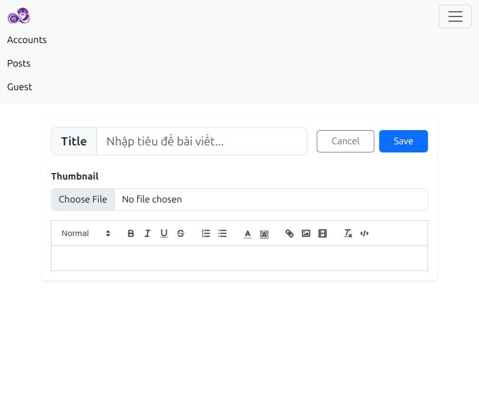
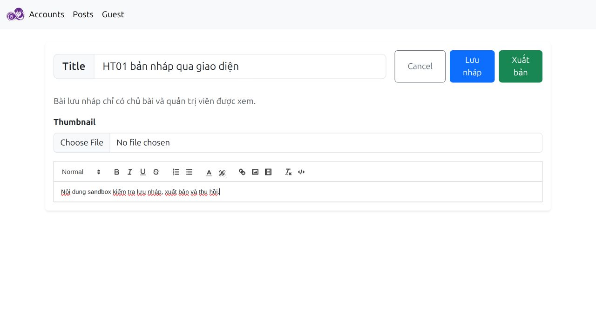
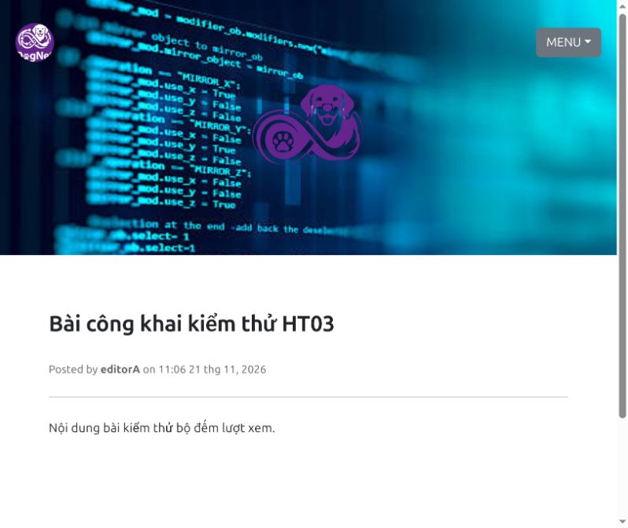
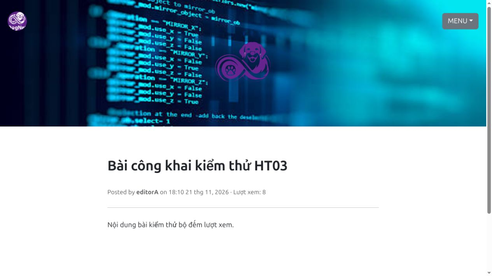

# Báo cáo kiểm thử bảo trì HT01 và HT03 MyDogNet

Ngày thực hiện: **21/11/2026**. Hai yêu cầu **đã được sửa trong mã nguồn và xác nhận trong sandbox**. Chưa commit, push hoặc deploy. Không coi kết quả này là nghiệm thu hệ thống production.

## Căn cứ và phiên bản

Đã đọc sáu DOCX mới nhất trong thư mục Drive được cung cấp, đặc biệt đặc tả 03, thiết kế 04 và mười ca TC-HT01-01…05, TC-HT03-01…05 trong tài liệu 05. Bản tải trước khi sửa được giữ ở `ht01_ht03/drive_goc/`. Đã đối chiếu báo cáo đợt HC01/HC02/DP01/DP03 và báo cáo HC03/HC04/HT02 của thành viên khác; không lấy kết luận cũ thay cho việc chạy lại.

Mốc trước sửa: **ca6d16452998d197a707abb5ec9e9df556931664**, nhánh **baotri_pm**, sau khi cập nhật fast-forward từ nhánh bảo trì đang có. Bản sau là working tree; danh sách tệp và SHA-256 tại [source-manifest.json](ht01_ht03/source-manifest.json). Giữ các thay đổi HC03/HC04/HT02 đã có. Không thay đổi nhánh main hay cấu hình Vercel.

## Môi trường cô lập

- Linux, SDK .NET 6.0.428, ASP.NET Core/EF Core SQL Server 6; frontend React, Vite 8.0.10, Node 26.13.0.
- SQL Server local tại localhost:14333, mỗi lần chạy tạo CSDL mới có tiền tố `MyDogNetMaintenanceAfter_`. Các tên cụ thể nằm trong environment.json của từng lần chạy. Không dùng dữ liệu MyDogNetLocal.
- Dịch vụ ảnh được thay bằng **FakeCloud** trong test host. Tắt lịch dọn ảnh; không gọi upload/xóa Cloudinary thật. CSDL thật, migration thật và giao dịch/khóa SQL thật; không dùng EF InMemory để kết luận về đồng thời.
- Tài khoản fixture Admin, Editor A/B. Thông tin kết nối và khóa JWT chỉ ở cấu hình local được Git bỏ qua; báo cáo và ảnh không chứa các bí mật đó.
- API sandbox loopback 5190/5191; frontend build trước/sau tại 5174/5175, proxy `/api` về API tương ứng. Kiểm tra qua proxy Vite local, chưa kiểm tra CDN/proxy Vercel thật.
- Snapshot trước sửa lấy từ git archive. Baseline nguyên bản có lỗi khởi tạo controller; chỉ test host baseline thêm adapter chọn constructor hai tham số để tiếp tục quan sát chức năng. **Không gọi đây là baseline nguyên trạng chạy thành công**; mã sản phẩm baseline vẫn giữ nguyên.

## HT01 Hoàn chỉnh luồng lưu nháp và xuất bản

### Hiện trạng và lý do bảo trì

CSDL và API tạo bài đã có IsPublished, API công khai đã lọc nháp, nhưng giao diện soạn bài chỉ có Save. API PATCH chưa cho đổi IsPublished, danh sách quản trị không trả trạng thái, thiếu lọc trạng thái và đường xem trước riêng. Người biên tập không hoàn thành được chu trình nháp → xuất bản → thu hồi, cũng khó biết bài đang ở trạng thái nào. Chưa có chính sách no-store cho GET công khai để kiểm tra sau thu hồi.

Baseline có bằng chứng: PATCH đổi trạng thái nhận **400**; danh sách không có `isPublished`; Cache-Control của GET chi tiết chưa có. Xem [baseline-results.json](ht01_ht03/baseline/baseline-results.json). Ảnh trước sửa cho thấy Save và bảng chưa có cột trạng thái.

### Sửa mã và hành vi cuối

1. DTO cập nhật nhận boolean IsPublished; PATCH chỉ cho replace title/content/thumbnail/isPublished. Từ chối chuỗi, số và null tại trường trạng thái; không cho sửa ViewCount hoặc tác giả qua PATCH.
2. Đọc trạng thái hiện tại trước khi áp dụng patch, giữ Id, AuthorId, CreatedAt và trạng thái nếu client chỉ sửa nội dung. Khi sửa nội dung hoặc trạng thái, ghi UpdatedAt UTC. Trả trạng thái và thời gian UTC từ API chi tiết.
3. Tiếp tục kiểm tra JWT/role và chủ sở hữu: Editor quản lý bài của mình; Admin quản lý tất cả; khách 401 và Editor khác chủ 403. GET công khai chỉ trả bài published, draft/withdrawn trả 404.
4. Danh sách quản trị trả IsPublished, ViewCount; hỗ trợ all/draft/published kết hợp phân quyền, tìm kiếm và phân trang. Tham số status là nullable, mặc định all khi không truyền. Header no-store/no-cache áp dụng ở API bài viết.
5. CreatePost có Lưu nháp và Xuất bản. UpdatePost hiển thị trạng thái, giữ trạng thái khi lưu nội dung, cho xuất bản hoặc thu hồi về nháp. Khóa cả hai nút khi đang upload/lưu; lỗi lưu giữ phần soạn để thử lại. Chặn form sửa rỗng khi tải bài thất bại.
6. PostManager thêm lọc trạng thái, badge, lượt xem và link Xem trước. Bỏ phản hồi cũ khi đổi bộ lọc nhanh. Trang PostPreview gọi API quản trị có quyền, chỉ đọc và không gửi POST lượt xem.

Không cần migration mới: IsPublished, ViewCount đã tồn tại; không tự xuất bản bài cũ và không đặt lại bộ đếm.

### Xác nhận

API kiểm tra tạo nháp, xuất bản, thu hồi, giữ metadata, phân quyền, lọc và giá trị sai. Trình duyệt dùng Quill thật tạo bài Id=4 ở trạng thái Nháp, lọc Nháp thấy bài; xem trước đọc được, URL công khai trả 404. Mở lại editor còn nội dung/tác giả/trạng thái; xuất bản đọc được công khai, rồi thu hồi trở lại 404. API khách không token và Editor khác chủ được kiểm tra riêng; tab trình duyệt dùng phiên Admin thử.

Proxy local đã đọc bài 200, thu hồi và GET có điều kiện trả **404**, danh sách không còn bài; cả ba phản hồi mang `Cache-Control: no-store, no-cache`. Không kiểm chứng hay xóa cache đã tồn tại trên production.

## HT03 Bộ đếm lượt xem bài viết

### Hiện trạng và lý do bảo trì

Model có ViewCount nhưng không có endpoint ghi lượt và không hiển thị số lượt riêng dưới tiêu đề. POST `/Post/{id}/view` ở baseline trả **404**. Bộ đếm cuối trang là lượt truy cập chung, không phải lượt xem của bài. Cần hoàn thiện việc đếm khi người dùng đọc bài công khai; phép đọc rồi cộng trong EF sẽ có nguy cơ mất cập nhật khi đồng thời.

### Sửa mã và hành vi cuối

- GET chi tiết chỉ đọc. Sau GET công khai thành công đúng bài và đúng lần điều hướng, frontend gửi POST `/post/{id}/view` một lần; không đếm nháp, 404 hoặc preview.
- API dùng UPDATE tham số hóa `ViewCount = ViewCount + 1 WHERE Id = @id AND IsPublished = 1`. Đọc số mới trong cùng transaction; khóa cập nhật được giữ tới commit. Khi không có dòng hợp lệ, trả 404. Không lấy số do client gửi, không đổi UpdatedAt.
- Phép tăng nguyên tử và điều kiện published được xử lý trong SQL; đồng bộ với giao dịch thu hồi. Sau commit thu hồi, yêu cầu ghi lượt không tăng nữa.
- Frontend lưu promise đã thử theo khóa điều hướng `location.key` và Id. Effect replay của StrictMode/rerender dùng lại promise, không tạo POST mới. Chỉ chấp nhận kết quả thuộc lượt mở hiện tại; bỏ GET bị hủy và POST cũ trả chậm khi đã chuyển bài.
- Hiển thị số từ phản hồi API dưới tiêu đề và tại danh sách. Nếu POST lỗi/timeout, vẫn giữ nội dung và số đã đọc; hiện thông báo nhẹ, không tự retry POST có khả năng đã commit. Một lần điều hướng mới có thể ghi thêm lượt.

Đây là số lượt mở công khai hợp lệ, không phải số người duy nhất; không hứa chống bot hoặc exactly-once khi mạng/proxy chủ động lặp lại request. Không thêm bảng theo dõi IP.

### Xác nhận

SQL thật: ba GET không tăng; một POST tăng đúng 1, không đổi UpdatedAt. **20 POST đồng thời đều 200, V0=8 → V1=28**, 20 giá trị trả về khác nhau. Nháp/id thiếu trả 404; ba lần preview không tăng. Body `viewCount=999999` chỉ tăng 1. Tranh chấp 20 lượt với thu hồi chỉ trả 200/404; sau thu hồi bộ đếm giữ nguyên.

Trình duyệt: bài tạo qua UI từ 0 → 1 khi mở, reload → 2, reload preview vẫn 2; bài fixture công khai có sẵn từ 7 → 8. GET độc lập sau đó vẫn 8. Kiểm thử component chạy React StrictMode thực sự; cùng object GET giả lập từ cache, điều hướng mới và POST lỗi đều được kiểm tra. Kết luận cache/StrictMode ở lớp component dùng mock Axios, không phải thử CDN thật.

## Nhật ký lỗi và sửa trong quá trình thực hiện

| Phát hiện | Nguyên nhân | Xử lý và kiểm tra lại |
|---|---|---|
| API bài viết không khởi tạo, cả 16 ca đầu thất bại | ca6d164 thêm constructor một tham số cho test bên cạnh constructor hai tham số; MVC không chọn được | Đánh dấu constructor dùng DI bằng ActivatorUtilitiesConstructor; giữ khả năng tương thích test cũ. Bộ API chạy lại đạt. Log đầu và results-initial-failed.json được giữ. |
| UI quản trị nhận 400 ở bộ lọc mặc định | status non-nullable bị kiểm tra required khi thiếu query; ca API đầu chỉ thử status cụ thể | Chuyển status nullable, chuẩn hóa mặc định all; thêm request không truyền status vào API-HT01-FILTER. Kiểm tra lại API và UI thành công. |
| Hai test frontend cũ lỗi sau khi có POST lượt xem | Mock post cũ trả undefined thay vì promise Axios | Cho mock trả promise viewCount; giữ nguyên assertion HC03/HC04. 31/31 test sau đó đạt. |
| Helper proxy báo thiếu Cache-Control dù HTTP có header | Helper tra key phân biệt hoa thường, proxy trả tên header chữ thường | Chuẩn hóa header về chữ thường; giữ kết quả lỗi helper và chạy lại 3/3 đạt. Đây là lỗi test helper, không phải thiếu header sản phẩm. |
| Lệnh gọi proxy bổ sung gặp 502 | Host sandbox đã dừng sau phiên UI | Khởi động lại cùng cấu hình private/CSDL, không seed đè; chạy lại proxy và GET đối chiếu thành công. |

Không thay log lỗi cũ bằng kết quả đạt. Những log chỉ chứa tên test/lỗi kỹ thuật được giữ; không lưu token/mật khẩu thật.

## Kết quả kiểm thử cuối

| Lớp kiểm thử | Đã chạy | Đạt | Không đạt cuối | Bằng chứng |
|---|---:|---:|---:|---|
| API mới HT01/HT03 và tích hợp SQL | 16 | 16 | 0 | api/results.json |
| Component frontend mới HT01/HT03 | 19 | 19 | 0 | frontend-results.json |
| Component hồi quy HC03/HC04/HT02 | 12 | 12 | 0 | frontend-results.json |
| API hồi quy HC01/HC02/DP01/DP03 | 27 | 27 | 0 | regression-api/results.json |
| Proxy HTTP local | 3 | 3 | 0 | proxy-results.json |
| Luồng UI thật được ghi riêng | 5 | 5 | 0 | browser-results.json và ảnh |

Các lớp trên có tiêu chí giao nhau, không cộng thành số ca độc lập của kế hoạch 55 ca. XUnit BackEnd.Tests không chạy được vì target net10.0 không tương thích SDK6 đang cài; không tính sáu test đó là đạt. Build backend qua integration harness và frontend production build thành công. Frontend còn cảnh báo chunk lớn hơn 500 kB. git diff --check không báo lỗi.

### Chi tiết 16 kịch bản API

| Mã | Kết quả | Thực tế |
|---|---|---|
| TC-HT01-01 | PASS | Nháp mặc định false; quản trị thấy; danh sách công khai không có; chi tiết 404. |
| TC-HT01-02 | PASS | PATCH true thành công; khách đọc được danh sách và chi tiết. |
| TC-HT01-03-ORIGIN | PASS | GET no-store; sau thu hồi GET có điều kiện trả 404, danh sách bỏ bài. Proxy kiểm tra riêng. |
| TC-HT01-04 | PASS | Đọc lại đúng Id, true, editorA, CreatedAt giữ nguyên; UpdatedAt UTC tăng. |
| TC-HT01-05 | PASS | Khách 401; Editor khác chủ 403; bài nháp không đổi. |
| API-HT01-FILTER | PASS | all/draft/published, tổng số và tìm kiếm khớp; không lộ bài B; trạng thái sai 400. |
| API-HT01-ADMIN | PASS | Admin xuất bản/thu hồi bài của Editor B thành công. |
| API-HT01-VALIDATION | PASS | Chuỗi/null/số bị chặn; không sửa trực tiếp ViewCount; trạng thái giữ nguyên. |
| API-HT01-PRESERVE | PASS | PATCH nội dung giữ IsPublished=true. |
| API-HT03-ATOMIC | PASS | Ba GET không tăng; một POST tăng đúng 1, trả số mới; UpdatedAt không đổi. |
| TC-HT03-02 | PASS | POST nháp/id thiếu 404; ba lần GET preview không tăng lượt. |
| TC-HT03-03 | PASS | 20×200; V0=8, V1=28; 20 giá trị trả về khác nhau. |
| API-HT03-UNTRUSTED | PASS | Body viewCount=999999 vẫn chỉ tăng đúng 1. |
| API-HT03-WITHDRAW-RACE | PASS | 20 lượt tranh chấp chỉ 200/404; sau commit thu hồi, POST 404 và số đếm giữ nguyên. |
| RG-HT02 | PASS | page/size biên sai 400; &, +, ? tìm đúng một bài công khai. |
| RG-HT01-MEDIA | PASS | Tạo nháp có URL FakeCloud vẫn ghi MediaReference trong SQL. |

### Đối chiếu mười ca theo kế hoạch

| Ca kế hoạch | Kết quả trong phạm vi sandbox | Nguồn xác nhận |
|---|---|---|
| TC-HT01-01 | Đạt sandbox | API tạo nháp bởi Editor; UI tạo nháp bằng Admin, quản trị thấy và public 404 |
| TC-HT01-02 | Đạt sandbox | Chủ bài publish qua API; UI Xuất bản và đọc công khai |
| TC-HT01-03 | Đạt sandbox local | API và proxy Vite local sau thu hồi 404/no-store; không đại diện CDN Vercel |
| TC-HT01-04 | Đạt sandbox | API Id/tác giả/CreatedAt/trạng thái/UTC; UI mở lại editor có nội dung |
| TC-HT01-05 | Đạt sandbox | API khách401, Editor khác chủ403, dữ liệu không đổi |
| TC-HT03-01 | Đạt sandbox | SQL+UI tăng1; component rerender không gửi thêm |
| TC-HT03-02 | Đạt sandbox | API nháp/id thiếu404, preview không tăng; UI nháp404 |
| TC-HT03-03 | Đạt sandbox SQL thật | 20×200; V0=8, V1=28 |
| TC-HT03-04 | Đạt component và UI | StrictMode/cùng object GET từ mock/new navigation; reload UI +1 |
| TC-HT03-05 | Đạt component có mô phỏng | POST timeout giả lập vẫn đọc bài, không tự retry; không gọi outage dịch vụ thật |

## Ảnh trước và sau

Ảnh chụp giao diện sandbox thật; không dựng lại màn hình. Trước và sau dùng các CSDL fixture khác nhau, cùng nội dung bài HT03. Kích thước viewport thực tế của hai phiên khác nhau; ảnh không dùng để chứng minh responsive.









Ảnh bổ sung trong [anh_truoc_sau](ht01_ht03/anh_truoc_sau): bảng trước/sau, lọc Nháp, preview, nháp public404, lượt1/lượt2, editor published và sau thu hồi404.

## Giới hạn và phần còn lại

Chưa deploy, chưa kiểm thử CDN/proxy production, Cloudinary thật, nhiều API instance hoặc thiết bị điện thoại thật. Yêu cầu override390px của browser không có hiệu lực (DOM vẫn1280px), nên không xác nhận mobile trong lần này. Các ca lỗi POST dùng mock ở component được ghi đúng mức bằng chứng.

Báo cáo cũ HC03/HC04/HT02 được giữ làm lịch sử. Bộ frontend12 ca chạy lại đạt các assertion hiện có; **không chứng minh toàn bộ các bước của ca kế hoạch cũ**, ví dụ test HC03 hiện có chưa thực thi request treo đủ15giây. Rà mã còn thấy nhánh timeout dùng controller.abort rồi bỏ cập nhật loading vì signal đã aborted; điểm này cần xử lý/kiểm thử riêng theo HC03, ngoài HT01/HT03. Không kết luận toàn bộ55 ca hoặc toàn bộ dự án đã hết lỗi.

Chưa nâng nền tảng .NET6 hoặc sửa target .NET10 của dự án xUnit trong đợt này. Không thay đổi schema/counter/trạng thái của dữ liệu thật. Không điền người phê duyệt hay giờ công thực tế khi chưa có thông tin.

## Chạy lại và tiếp nhận

Từ thư mục `source code/MyDogNet`, SQL Server local Healthy và có `BackEnd/appsettings.Local.json` riêng:

```bash
python3 maintenance-tests/run-publication.py --output /tmp/mydognet-ht-api
python3 maintenance-tests/run.py
cd front-end
npm ci
npx vitest run
VITE_API_URL=/api npm run build
```

Harness tự tạo CSDL thử mới, guard chỉ nhận kết nối SQL loopback và tên database thử. Không tự xóa CSDL sau chạy để giữ chứng cứ. Báo cáo không chứa connection string; không copy cấu hình private lên Git.

Để mở UI sau sửa: chạy `python3 maintenance-tests/run-publication.py --serve --output /tmp/mydognet-ht-ui` ở terminal thứ nhất, rồi `VITE_API_URL=/api npm run build` và `npx vite preview --config vite.sandbox.config.js --port 5175 --strictPort` ở front-end. Dùng tài khoản fixture từ Runner.cs, không dùng tài khoản production. Kiểm tra proxy bằng `python3 maintenance-tests/check-publication-proxy.py --output /tmp/mydognet-ht-proxy`.

Trước khi áp dụng thật: sao lưu dữ liệu, review diff trên nhánh baotri_pm, triển khai đồng bộ API và frontend rồi kiểm tra publish/withdraw/count qua proxy thực. HT01/HT03 không có migration mới, nhưng môi trường phải có các migration trước của dự án. Không reset IsPublished hoặc ViewCount hàng loạt. Nếu quay lui frontend/API, giá trị đã lưu vẫn giữ trong CSDL; cần chặn luồng công khai phù hợp trong lúc triển khai.

## Tài liệu Word và Drive

Đã cập nhật **đúng sáu file DOCX gốc trên Drive**, giữ ID và thư mục, lên phiên bản **0.3 ngày 21/11/2026**. Đã đọc lại nội dung cả sáu file, rồi tải lại bản raw và đối chiếu byte/SHA-256: **6/6 trùng hoàn toàn** với bản local đã kiểm tra. Bản local ở `ht01_ht03/word_cap_nhat/`, bản tải lại ở `ht01_ht03/drive_doc_lai/`. Biên nhận: [drive-update-receipts.json](ht01_ht03/drive-update-receipts.json); đối chiếu byte: [drive-byte-verification.json](ht01_ht03/drive-byte-verification.json).

Đã render bằng LibreOffice đóng gói và xem từng trang PNG của sáu tài liệu, tổng 104 trang ở lần cuối; các trang bị ảnh hưởng được render và xem lại sau khi sửa mục lục/bố cục. Nhật ký kiểm tra: [word-qa-audit.json](ht01_ht03/word-qa-audit.json). Giữ lịch sử các đợt trước; khôi phục ảnh HC02 sau sửa bị thiếu trong bản Word nguồn bằng ảnh chứng cứ 17/11 đã lưu, không coi là một lần kiểm thử HC02 qua UI mới. Ảnh HT01/HT03 trong Word chỉ cắt phần trống dưới viewport ở bố cục tài liệu; các JPEG chứng cứ gốc không bị thay đổi.

Thư mục Drive: https://drive.google.com/drive/u/1/folders/1N3ONPEoH6a6mRVPIFL8hQlqFb7AXcKD3 .
